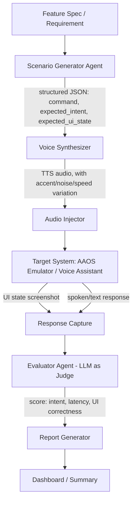
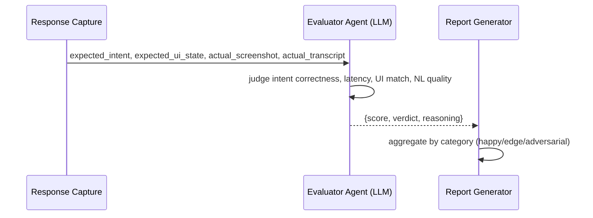

# VoiceQA — LLM-Driven Voice Assistant Testing Framework

> An AI-driven framework that generates, synthesizes, injects, and evaluates voice command tests for automotive/embedded voice assistants — replacing manually scripted voice test cases with LLM-generated scenarios and LLM-as-judge evaluation.

---

## Table of Contents

- [Motivation](#motivation)
- [What This Project Does](#what-this-project-does)
- [How to Run](#how-to-run)
- [System Architecture](#system-architecture)
- [Pipeline Stages](#pipeline-stages)
  - [1. Test Scenario Generation](#1-test-scenario-generation)
  - [2. Voice Synthesis & Injection](#2-voice-synthesis--injection)
  - [3. Response Capture](#3-response-capture)
  - [4. LLM-Based Evaluation](#4-llm-based-evaluation)
  - [5. Reporting & Dashboard](#5-reporting--dashboard)
- [Tech Stack](#tech-stack)
- [Project Structure](#project-structure)
- [Installation](#installation)
- [Usage](#usage)
- [Evaluation Metrics](#evaluation-metrics)
- [Roadmap](#roadmap)
- [Why This Project](#why-this-project)
- [License](#license)

---

## Motivation

Voice interaction is now a core part of automotive and embedded infotainment systems, but voice test coverage is usually shallow — a fixed list of hand-written commands, rarely covering paraphrasing, accents, background noise, or ambiguous phrasing. Writing enough manual test cases to cover this space properly doesn't scale.

This project uses an LLM to generate a much wider and more realistic set of voice test scenarios than a human would typically write, synthesizes them into real audio, injects that audio into the target system, and then uses a second LLM as an evaluator to judge whether the system responded correctly — including partial credit for "close but wrong" responses that a simple string-match evaluator would miss entirely.

---

## What This Project Does

- Generates diverse voice command test cases from a feature description (happy-path, paraphrased, edge-case, and adversarial variants)
- Converts generated commands into real speech audio, with configurable accent/speed/background-noise variation
- Injects that audio into a target voice assistant (Android Automotive OS emulator or a mock intent-handling app)
- Captures the system's response (UI state + audio/text reply)
- Uses an LLM-as-judge to score intent recognition, latency, and response quality
- Produces a categorized pass/fail report and dashboard

---

## How to Run

The fastest path — fully offline, no API key, no emulator, no heavy audio
deps required:

```bash
# 1. Set up a virtual environment and install core dependencies
python -m venv .venv
.venv\Scripts\activate          # Windows
# source .venv/bin/activate     # macOS/Linux
pip install -r requirements.txt

# 2. Generate scenarios (deterministic mock data, no LLM call)
python -m voiceqa.generator.scenario_generator \
  --feature "voice-controlled climate control" \
  --output voiceqa/scenarios/climate.json \
  --dry-run

# 3. Run the full pipeline against the mock in-car assistant
python run_pipeline.py --scenarios voiceqa/scenarios/climate.json --mock --dry-run

# 4. View the results
streamlit run voiceqa/reporting/dashboard.py
```

Open the URL Streamlit prints (defaults to `http://localhost:8501`) to see
pass rate by category, latency distribution, and failure clustering.

**To use a real LLM** for scenario generation and LLM-as-judge evaluation
instead of the offline mock/rule-based fallbacks:
```bash
copy .env.example .env          # then set ANTHROPIC_API_KEY or OPENAI_API_KEY
python -m voiceqa.generator.scenario_generator --feature "voice-controlled climate control" --output voiceqa/scenarios/climate.json
python run_pipeline.py --scenarios voiceqa/scenarios/climate.json --mock
```
(Just drop `--dry-run` — everything else is identical.)

**To run the test suite:**
```bash
pip install -r requirements-dev.txt
pytest
```

**On `--device` (a real Android Automotive OS emulator) instead of `--mock`:**
this flag exists and pushes/injects audio over `adb`, but it targets a voice
assistant app running *on* the emulator — a stock AAOS image has no voice
stack wired to its climate APIs out of the box, so there's nothing to
respond unless you've installed one. The virtual-microphone trigger is also
a best-effort placeholder (see the caveat in
[voiceqa/injection/audio_injector.py](voiceqa/injection/audio_injector.py)).
`--mock` against the bundled rule-based assistant in
[voiceqa/mock_target/mock_assistant.py](voiceqa/mock_target/mock_assistant.py)
is the fully working, realistic way to run this project end to end.

See [Installation](#installation) and [Usage](#usage) below for the full
set of options (optional heavier deps, provider selection, etc.).

---

## System Architecture



---

## Pipeline Stages

### 1. Test Scenario Generation

The **Scenario Generator Agent** takes a plain-language feature description and produces a structured set of test cases spanning four categories:

| Category | Example |
|---|---|
| Happy path | "Set temperature to 22 degrees" |
| Paraphrased | "Make it warmer", "22 please" |
| Edge case | Ambient noise mentioned mid-command, interruption, code-switching (German/English) |
| Adversarial | Similar-sounding but incorrect commands |

```python
def generate_scenarios(feature_description: str) -> list[dict]:
    prompt = f"""
    Generate voice command test scenarios for this feature: {feature_description}

    Produce a JSON list of objects, each with:
    - "command": the spoken text
    - "category": one of "happy_path", "paraphrased", "edge_case", "adversarial"
    - "expected_intent": the intent this should trigger
    - "expected_ui_state": what the UI should show after this command

    Include at least 3 examples per category.
    """
    return call_llm_json(prompt)
```

### 2. Voice Synthesis & Injection

Convert each generated command into audio, then feed it into the target system.

**Synthesis (Coqui TTS — free, local, fully self-contained for a portfolio project):**
```python
from TTS.api import TTS

tts = TTS(model_name="tts_models/en/ljspeech/tacotron2-DDC")

def synthesize(command: dict, output_path: str, speed: float = 1.0):
    tts.tts_to_file(text=command["command"], file_path=output_path, speed=speed)
```

**Variation layer** (accent, speed, background noise) — this is what makes the test suite meaningfully harder than a single clean recording per command:
```python
from pydub import AudioSegment

def add_background_noise(speech_path: str, noise_path: str, output_path: str, noise_db: float = -20):
    speech = AudioSegment.from_wav(speech_path)
    noise = AudioSegment.from_wav(noise_path) + noise_db
    noise = noise[:len(speech)]
    (speech.overlay(noise)).export(output_path, format="wav")
```

**Injection** — feed the resulting audio into the target as a virtual microphone input, or as a direct audio file if the target system/emulator supports file-based voice input.

### 3. Response Capture

After each injected command, capture both the visual and auditory outcome:

```python
def capture_response(adb_client, output_dir: str):
    screenshot_path = f"{output_dir}/ui_state.png"
    adb_client.screenshot(screenshot_path)
    ui_hierarchy = adb_client.dump_ui()
    return {"screenshot": screenshot_path, "ui_hierarchy": ui_hierarchy}
```

Use Whisper (or the platform's own STT) to transcribe any spoken reply back to text for the evaluator to read.

### 4. LLM-Based Evaluation

The **Evaluator Agent** compares expected vs. actual outcome and scores the result — this is the piece that goes beyond simple string matching:



```python
def evaluate_response(scenario: dict, actual: dict) -> dict:
    prompt = f"""
    Expected intent: {scenario['expected_intent']}
    Expected UI state: {scenario['expected_ui_state']}
    Actual UI hierarchy: {actual['ui_hierarchy']}
    Actual spoken/text response: {actual['transcript']}

    Score this response from 0-1 on:
    - intent_correctness
    - ui_state_correctness
    - response_naturalness

    Return JSON with those three scores, an overall "pass" boolean, and a short "reasoning" string.
    """
    return call_llm_json(prompt)
```

### 5. Reporting & Dashboard

A lightweight Streamlit dashboard summarizing results by category, with latency distribution and failure clustering:

```python
import streamlit as st
import pandas as pd

def render_dashboard(results: list[dict]):
    df = pd.DataFrame(results)
    st.metric("Overall pass rate", f"{df['pass'].mean():.0%}")
    st.bar_chart(df.groupby("category")["pass"].mean())
    st.dataframe(df[~df["pass"]][["command", "category", "reasoning"]])
```

The system should also auto-generate a natural-language summary, e.g.: *"Voice recognition degrades 23% under simulated road noise, concentrated in the 'climate control' intent category."*

---

## Tech Stack

- **Scenario generation & evaluation:** Claude / GPT-4o API
- **TTS:** Coqui TTS (local, free) or Azure/Google Cloud TTS
- **Audio processing:** `pydub` for noise/speed variation
- **STT (response transcription):** OpenAI Whisper
- **Target environment:** Android Automotive OS emulator, or a mock intent-handling app if no real voice stack is available
- **UI state capture:** ADB (screenshot + UIAutomator dump)
- **Dashboard:** Streamlit

---

## Project Structure

```
project_2/
├── voiceqa/
│   ├── config.py                     # env vars, paths, provider settings
│   ├── llm_client.py                 # unified Claude/GPT-4o/mock LLM client
│   ├── generator/
│   │   └── scenario_generator.py     # LLM-based test scenario generation
│   ├── synthesis/
│   │   ├── tts.py                    # Coqui TTS -> pyttsx3 -> placeholder-tone fallback chain
│   │   └── variation.py              # accent/speed/noise augmentation (pydub or pure-stdlib fallback)
│   ├── injection/
│   │   ├── adb_client.py             # thin adb CLI wrapper
│   │   └── audio_injector.py         # feeds audio into target system (mock or adb)
│   ├── capture/
│   │   ├── stt.py                    # Whisper transcription + deterministic simulation fallback
│   │   └── response_capture.py       # screenshot + UI dump + transcript, standardized
│   ├── evaluation/
│   │   └── evaluator_agent.py        # LLM-as-judge, with rule-based fallback scorer
│   ├── reporting/
│   │   ├── report_generator.py       # aggregation, NL summary, results.json/csv
│   │   └── dashboard.py              # Streamlit dashboard
│   ├── mock_target/
│   │   └── mock_assistant.py         # rule-based mock in-car climate assistant
│   ├── scenarios/
│   │   └── *.json                    # generated test scenario sets
│   └── output/                       # audio/capture/results (gitignored)
├── tests/                            # pytest suite (no network/API keys required)
├── run_pipeline.py                   # orchestrates the full pipeline
├── requirements.txt                  # core deps (LLM clients, pandas, streamlit)
├── requirements-optional.txt         # TTS / pydub / whisper / pyttsx3
├── requirements-dev.txt
├── .env.example
└── README_voiceqa.md
```

---

## Installation

```bash
# 1. Clone
git clone https://github.com/<your-username>/voiceqa.git
cd project_2

# 2. Create a virtual environment and install core dependencies
python -m venv .venv
.venv\Scripts\activate          # Windows
# source .venv/bin/activate     # macOS/Linux
pip install -r requirements.txt

# 3. (Optional) install heavier deps for real TTS/STT/audio variation
pip install -r requirements-optional.txt

# 4. (Optional) confirm ADB access to a real target device/emulator
adb devices

# 5. Set your LLM API key (optional — the pipeline runs fully offline without it)
copy .env.example .env          # then fill in ANTHROPIC_API_KEY or OPENAI_API_KEY
```

## Usage

**Quick start — no API key, no emulator, no heavy deps required:**
```bash
python -m voiceqa.generator.scenario_generator \
  --feature "voice-controlled climate control" \
  --output voiceqa/scenarios/climate.json \
  --dry-run

python run_pipeline.py --scenarios voiceqa/scenarios/climate.json --mock --dry-run

streamlit run voiceqa/reporting/dashboard.py
```

This runs the whole pipeline — generation, synthesis, a simulated
injection/response round-trip through the mock in-car climate assistant in
[voiceqa/mock_target/mock_assistant.py](voiceqa/mock_target/mock_assistant.py),
and a rule-based fallback evaluator — and produces a real dashboard you can
open in a browser. Drop `--dry-run` once an `ANTHROPIC_API_KEY` or
`OPENAI_API_KEY` is set to use the real LLM-as-judge evaluator instead of the
rule-based fallback.

**Generate scenarios for a feature (real LLM):**
```bash
python -m voiceqa.generator.scenario_generator --feature "voice-controlled climate control" --output voiceqa/scenarios/climate.json
```

**Run the full pipeline (synthesize → inject → capture → evaluate → report):**
```bash
# Against the mock intent-handling app:
python run_pipeline.py --scenarios voiceqa/scenarios/climate.json --mock

# Against a real AAOS emulator/device:
python run_pipeline.py --scenarios voiceqa/scenarios/climate.json --device emulator-5554
```

**View the dashboard:**
```bash
streamlit run voiceqa/reporting/dashboard.py
```

**Run the test suite:**
```bash
pip install -r requirements-dev.txt
pytest
```

### Implementation notes

- Every heavy/external dependency (Coqui TTS, Whisper, pydub, a real LLM
  provider, ADB) has a documented fallback, so the pipeline is runnable end
  to end on a bare checkout. See the docstrings in
  [voiceqa/synthesis/tts.py](voiceqa/synthesis/tts.py),
  [voiceqa/synthesis/variation.py](voiceqa/synthesis/variation.py),
  [voiceqa/capture/stt.py](voiceqa/capture/stt.py), and
  [voiceqa/llm_client.py](voiceqa/llm_client.py) for exactly what each
  fallback does and when it kicks in.
- `pydub` depends on the stdlib `audioop` module, removed in Python 3.13+;
  `voiceqa/synthesis/variation.py` falls back to a pure-stdlib WAV
  mixer/resampler automatically on newer interpreters.
- Real device audio-output capture (the assistant's spoken reply) is
  emulator/build-dependent over `adb`; in `--device` mode the transcript is
  recovered from on-screen text in the UIAutomator dump as a pragmatic
  fallback — see the docstring in
  [voiceqa/capture/response_capture.py](voiceqa/capture/response_capture.py).

---

## Evaluation Metrics

- Number of test scenarios auto-generated vs. a hand-written baseline
- Pass rate broken down by category (happy path / paraphrased / edge case / adversarial)
- Bug/edge-case discovery rate vs. manual testing
- Response latency distribution
- Estimated time saved vs. manually authoring the same scenario coverage

---

## Roadmap

- [ ] Multi-language support (German/English code-switching scenarios, given the target job market)
- [ ] Real device microphone injection (beyond emulator/file-based injection)
- [ ] Confidence-calibrated evaluator (flag when the LLM judge itself is uncertain, rather than forcing a binary pass/fail)
- [ ] Historical trend tracking across builds (is voice accuracy regressing release-over-release?)

---

## Why This Project

Built to demonstrate applied LLM engineering beyond simple chatbot use cases: using one model to generate adversarial test coverage and a second model as an evaluator, on a genuinely hard-to-test surface (voice) in an automotive/embedded context. Complements a classic test-automation background by showing how AI can extend, not replace, existing QA practice.

---

## License

MIT
